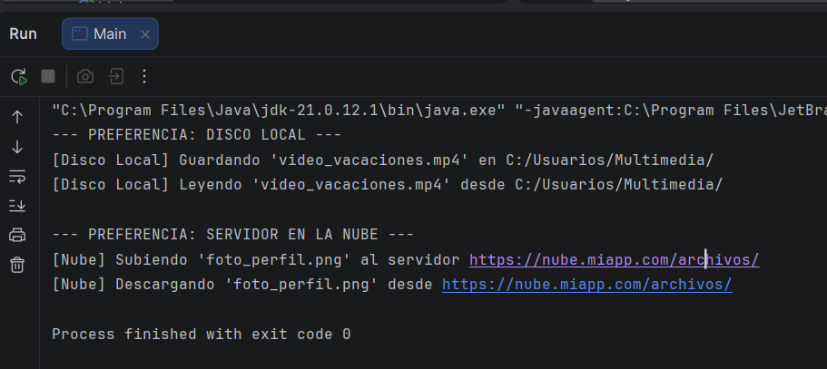

- Diseño de Software - Módulo 3
- Ejercitación 3.E.2 - Patrón Factory Method
Ejercicio 2: Creador de Conexiones a Repositorios de Archivos
Contexto del problema:
Una aplicación de escritorio permite almacenar archivos multimedia ya sea en el disco local o en un servidor en la nube, requiriendo un punto de creación unificado para los servicios de almacenamiento según la preferencia del usuario.

Objetivo de aprendizaje:
Aplicar el patrón Factory Method para encapsular la lógica de selección y construcción de objetos con interfaces similares pero comportamientos subyacentes distintos.

Requisitos funcionales:

Proveer una interfaz de almacenamiento genérica que declare métodos para guardar y recuperar archivos.

Implementar creadores específicos para almacenamiento local y almacenamiento en la nube que devuelvan su respectivo conector configurado.

Restricciones técnicas:

La lógica que decide qué creador instanciar debe estar separada de la lógica de negocio que gestiona los archivos.

Cada creador concreto debe sobrescribir el método de fábrica de la clase base para retornar el conector adecuado.
***
# Lógica y Funcionamiento del Programa:
Para resolver este ejercicio apliqué el patrón Factory Method para que la aplicación pueda guardar y recuperar archivos multimedia tanto en disco local como en la nube sin mezclar la configuración de cada servicio con el manejo de los archivos.

- Interfaz Almacenamiento: Define el contrato genérico con los métodos guardar() y recuperar() para operar cualquier repositorio de la misma manera.

- Clases AlmacenamientoLocal y AlmacenamientoNube: Implementan la interfaz y simulan la subida/bajada o lectura/escritura según la ruta local o la dirección del servidor configurado.

- Clase FabricaAlmacenamiento: Es la clase creadora abstracta que declara el método de fábrica crearAlmacenamiento().

- Clases FabricaLocal y FabricaNube: Son los creadores concretos. Cada uno sobrescribe el método de fábrica para devolver su conector correspondiente ya inicializado con su ruta o URL.

- Clase Main: Separé la elección de la fábrica en el método seleccionarFabrica() y el uso de los archivos en gestionarMultimedia(). De este modo, la lógica que trabaja con los archivos interactúa únicamente contra la interfaz Almacenamiento sin depender de dónde se guardan físicamente.
***
# Ejecucion por consola
